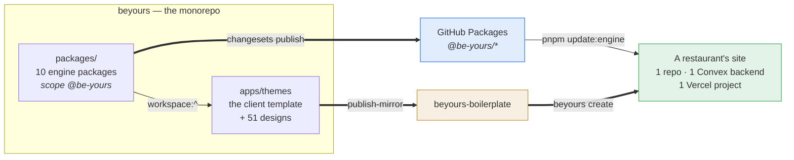

# BeYours

### Turnkey online ordering for restaurants — with no commission on direct sales

A restaurant buys its own ordering site, once. It runs on its own backend, under
its own domain, with its own colours. Every order placed on it is the
restaurant's, whole.

[**beyours.fr**](https://beyours.fr)

`Next.js 16` · `React 19` · `Convex` · `TypeScript strict` · `pnpm` · `Turborepo`

---

## What this organisation holds

Two repositories, and they are not two versions of the same thing. One is where
the engine is built; the other is what a restaurant actually receives.

| Repository | What it is |
| --- | --- |
| [**`beyours`**](https://github.com/be-yours/beyours) | The monorepo. Three applications, ten engine packages, the 51 design templates, and the scripts that turn all of it into a client site. |
| [**`beyours-boilerplate`**](https://github.com/be-yours/beyours-boilerplate) | The distribution mirror. Every client site is cloned from it, and pulls its updates from it. It is generated from the monorepo, never edited by hand. |

---

## How a restaurant's site comes to exist

Two channels, deliberately. Engine logic travels as **published packages**, so a
fix reaches every client with a version bump. The template — pages, templates,
the client's own zone — travels as **git**, so a restaurant can diverge from it
and still take updates.

One Convex deployment per client. Isolation here is a whole backend, not a tenant
column in a shared database.

---

## The three applications

| | Workspace | Audience |
| --- | --- | --- |
| **`apps/site`** | `@be-yours/site` | The commercial site: marketing, the template catalogue, checkout, the affiliate portal. It depends on **none** of the engine packages — it sells the product, it is not an instance of it. |
| **`apps/reference`** | `@be-yours/reference` | The engine's test bench. Every feature is built and proven here first. Sold to nobody. |
| **`apps/themes`** | `@be-yours/themes` | The shippable twin of the bench, plus what the engine cannot carry: the client zone, the 51 designs, the site-creation scripts. |

`reference` and `themes` are near-identical on purpose, and a guard
(`pnpm check:divergence`) fails the build on any difference that is not a
recorded decision. A feature proven on the bench and forgotten on the template is
a defect, and this is how it gets caught.

---

## The engine

Ten packages under `@be-yours`, published privately to GitHub Packages.

| | |
| --- | --- |
| `convex-schema` · `convex-functions` | the data model and the backend functions |
| `ui` · `admin` | the design system, and the whole back-office |
| `core` | auth, i18n, payments, AWS, e-mail transport |
| `restaurant` | ordering, cart, business rules |
| `cms` | the page and content editor |
| `integrations` | Uber Eats, Deliveroo, Uber Direct |
| `marketing` | campaigns, segments, subscribers |
| `mcp-server` | the package registry, as an MCP server |

<b>What a restaurant gets, concretely</b>

 

- **Multi-location.** One owner, one to N establishments. Hours, geolocation,
  status and catalogue per establishment.
- **Catalogue.** Products, categories, options, scheduling, stock.
- **Orders.** Delivery, collection, dine-in — created, tracked and settled.
- **Kitchen display.** Real-time tickets, multi-station routing, automatic
  printing through the browser, reprint, claim locks so two tablets never take
  the same ticket.
- **Payments.** Stripe, SumUp, PayPal and cash, with refunds. A cash-only
  establishment removes the card tile entirely rather than showing a dead one.
- **Delivery platforms.** Menu sync and inbound orders from Uber Eats and
  Deliveroo; deliveries dispatched through Uber Direct.
- **Gamification.** QR codes on tables, social actions, wheel and scratch-card
  games with an owner-controlled win ratio, prizes redeemed in the restaurant.
- **Languages.** Any language the owner adds, with GPT-assisted translation of
  the catalogue, or by hand.
- **Personal data.** Access, portability, erasure, consent and retention are
  implemented, not promised — a French restaurant running this is the data
  controller, and the engine answers for it. A paid order is anonymised rather
  than deleted, and its invoice is kept whole, because an invoice is a numbered
  fiscal document.
- **Design.** 51 templates across five verticals, applied at clone time, then
  per-establishment colours, typography, logo and favicon at runtime.

---

## How the work is done

**Documentation is written from the code, and says where the product falls
short.** The monorepo carries four documents — architecture, features, testing,
deployment — and each one states plainly what is built, what is partial, and what
is not built at all. A feature is not described as shipping because the sales
page says so.

**A figure with no commit attached is not a measurement.** Counts in this
organisation's documentation carry the date and the commit they were measured
against, and the command that produced them, so they can be re-run rather than
believed. When a count goes stale, it is re-measured — not quietly kept.

**Accessibility is measured, not asserted.** A contrast sweep reads every
component and fails below the WCAG 2.1 AA floor. Reduced-motion is honoured in
both animation systems, because a stylesheet cannot reach inline frames. Cart
changes are announced to screen readers from a region that is in the document
before it changes.

**A delivered site never invents its own social proof.** No hard-coded
testimonial, rating or customer count ships in a client's template — not even as
a placeholder. A figure about an establishment is the establishment's to state,
and a test holds the line.

---

## Measured on 18 September 2026, at `9eb6484c`

| | |
| --- | --- |
| Applications | 3 |
| Engine packages | 10 |
| Design templates | 51, across 5 verticals, 5 files each |
| Unit tests | 9 909, across 18 workspaces |
| Page routes | 37 · 111 · 111 (`site` · `reference` · `themes`) |
| Route handlers | 1 · 6 · 9 |

True of that commit and of no other. Re-run the counts rather than trusting
them — every one of them comes from a command in the repository's README.

---

**BeYours** is the product. **Be in Digital** is the agency that builds it,
a trade name of TUUM AGENCY SAS.

